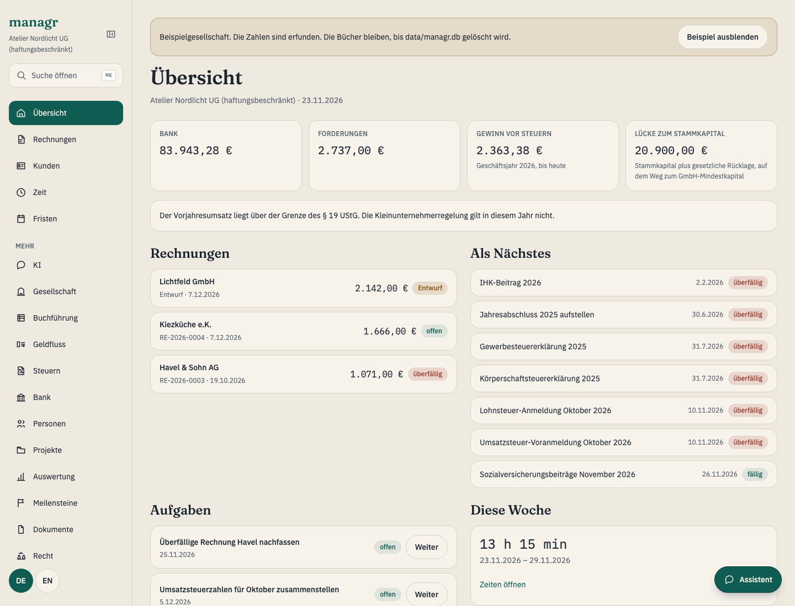
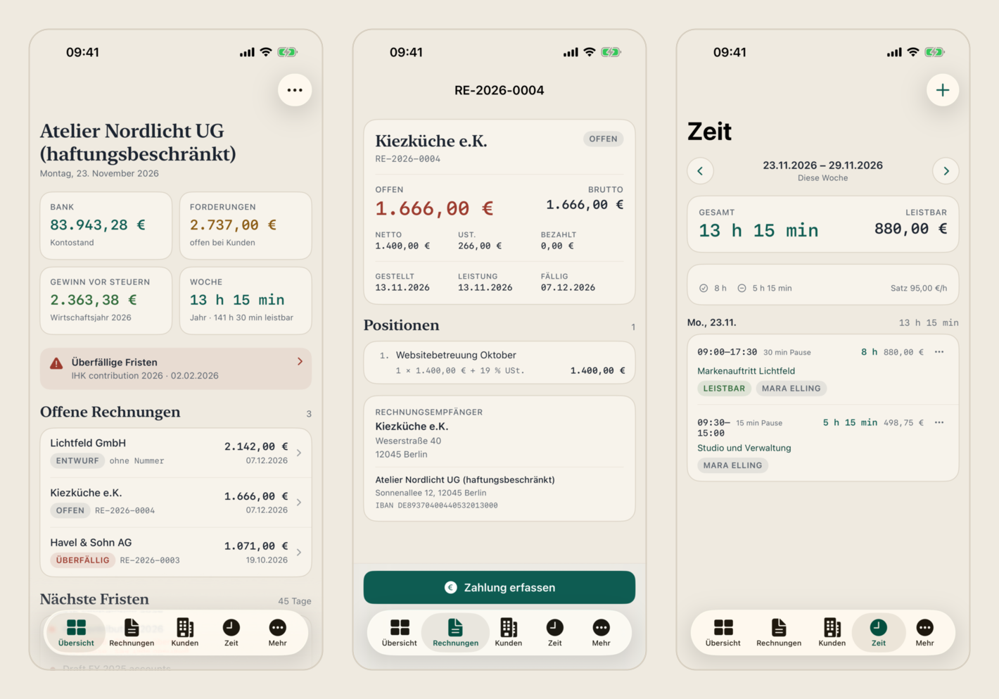

# managr

A local desk for German companies: company records, obligations, invoices, a double-entry ledger, people, social-insurance estimates, time, documents, and legal notes. Each company keeps its own books; the switcher changes the whole desk.

**A planning aid.** It does not file a return, calculate wage tax, or decide social-insurance status.



## Run it

```bash
bun install
bun run dev
```

Open [http://localhost:3000](http://localhost:3000). The first launch creates `data/managr.db` and loads the sample company Atelier Nordlicht UG. Delete that file to start over. Uploads live in `data/uploads`.

## What it does

- **Company and books** — UG, GmbH, AG, OHG, KG, GbR, PartG, e.K., and Einzelunternehmen; shareholders, Stammkapital, the §5a reserve, and shareholder loans; a SKR03 ledger, trial balance, profit, and tax estimates.
- **Invoices** — draft, issue, pay, and void; §14 UStG and §35a GmbHG particulars; a printable invoice; XRechnung 3.0.2 download. The file is not sent.
- **Tax** — VAT advance and annual, corporate-tax, and trade-tax returns: prepare, check, freeze the figures, record a manual filing, and export Mein ELSTER, CSV, or JSON. No ELSTER transmission.
- **People** — employment, 2026 minijob / midijob / regular contribution estimates, vacation, salary history, a payroll journal, founder health cover, and an org chart.
- **Time and projects** — time with §3/§4 ArbZG warnings, tasks, projects, deliverables, hourly rates at four levels, and a yearly analysis with a printable customer report. A read-only test run replays recorded days at `/time/playback`.
- **Obligations and legal** — VAT, wage tax, trade tax, corporate tax, social insurance, disclosure, IHK, Berufsgenossenschaft, custom deadlines, a legal checklist, and shareholder resolutions.
- **Bank and money flow** — a read-only Qonto sync per company; a year from invoicing to the tax office with the VAT chain and actual bank movements.
- **Assistant and MCP** — a chat panel and an MCP endpoint over the same tools the screens use, with a confirmation gate for writes in the panel.
- **Search** — `⌘K` / `Ctrl+K` across pages and the records behind them.
- **Multiple companies** — separate customers, invoices, numbering, ledger, people, time, documents, deadlines, and legal records.
- **Sources** — every rule on a screen links to the official websites behind it; `/sources` lists the register.

## iPhone app

`ios/` is a native SwiftUI client for the same desk, not a second backend. It reads `GET /api/views/[name]`, writes through `POST /api/tools`, and streams the assistant from `/api/assistant`, which runs the same tool registry, validation, and journal postings as the browser and MCP. Writes from the assistant wait in a confirmation card. The phone connects over your Wi-Fi; the Mac still holds the database. No account, no cloud.



Build and sideload steps: [ios/README.md](ios/README.md). The same notes are on the published site at [docs/IPHONE.md](docs/IPHONE.md).

## Documentation

| Topic | Where |
| --- | --- |
| Architecture, request flow, data model | [docs/ARCHITECTURE.md](docs/ARCHITECTURE.md) |
| Domain rules: company law, tax, invoices | [docs/DOMAIN.md](docs/DOMAIN.md) |
| Assistant, tools, MCP | [docs/MCP-ASSISTANT.md](docs/MCP-ASSISTANT.md) |
| iPhone app | [ios/README.md](ios/README.md) |
| Tax-return workspace | [docs/STEUERERKLAERUNG-PLAN.md](docs/STEUERERKLAERUNG-PLAN.md) |
| XRechnung validation | [docs/XRECHNUNG-VALIDATION.md](docs/XRECHNUNG-VALIDATION.md) |
| Roadmap | [docs/ROADMAP.md](docs/ROADMAP.md) |

## Demo and production books

The desk always opens `data/managr.db`. Two saved copies sit beside it:

```bash
bun run db:demo      # open the demo copy
bun run db:prod      # open the production copy
bun run db:status    # show the active copy and both saved files
bun run db:demo:set  # save the open books as the demo copy
```

Production must start without demo books:

```bash
bun run db:prod:init -- --name "Your UG (haftungsbeschränkt)"
bun run db:prod:set -- --from ~/backup/managr.db
```

Stop the desk before switching and start it again afterwards. Uploads in `data/uploads` are shared.

## Docker

```bash
docker compose up --build
```

The desk is at [http://localhost:3000](http://localhost:3000), the site at [http://localhost:3001/managr/](http://localhost:3001/managr/), and the notes at [http://localhost:3001/managr/docs](http://localhost:3001/managr/docs). Compose keeps `data/` on this computer and does not host the desk for anyone else.

```bash
bun run docker:restart
bun run docker:status
bun run docker:logs
bun run docker:down
```

## Checks

```bash
bun run test
bun run typecheck
bun run build
```

## Notes

- One user, one computer, no sign-in. The database is a SQLite file; the browser never opens it.
- The desk opens in German. Switch to English with DE/EN in the sidebar, or under Mehr on a phone. Dates and amounts stay in German format; a printed invoice stays German.
- Deletes are soft and restorable from `/trash`.
- The MCP endpoint is `http://127.0.0.1:3000/api/mcp` while the desk runs; the iPhone client uses `/api/tools`. Neither has a sign-in. Keep the desk on a trusted network.
- The assistant can read providers and models from a local [opencode](https://opencode.ai) installation, or use `MANAGR_AI_MODEL`, `MANAGR_AI_BASE_URL`, and `MANAGR_AI_API_KEY` for an OpenAI-compatible endpoint. See [docs/MCP-ASSISTANT.md](docs/MCP-ASSISTANT.md).
- Engineering rules live in `.grok/skills/managr-engineering/SKILL.md`.

## Published site

`website/` is the Docusaurus site. The marketing page is the root and is translated at `/de/`. Docs are served at `/docs` and `/de/docs`.

```bash
bun install --cwd website
bun run docs
```

Open [http://localhost:3001/managr/](http://localhost:3001/managr/). A push to `main` builds and deploys to GitHub Pages at [https://403access.github.io/managr/](https://403access.github.io/managr/).