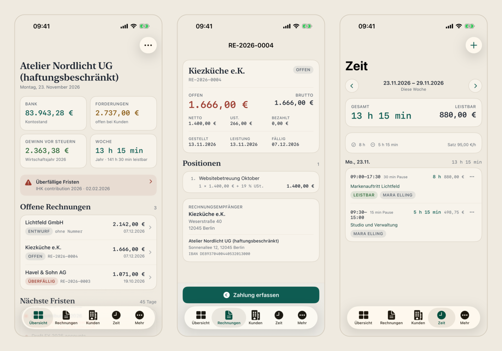

# iPhone app

`ios/` is a native SwiftUI client for the same local desk. It is not a second backend and it keeps no copy of the books: every screen fetches from the Next.js server on your Mac over the local Wi-Fi. The Mac still owns `data/managr.db` and the journal.



The screenshots use the sample company that is loaded on first launch.

## What it covers

- **Overview** — bank, receivables, profit before tax, open invoices, the next deadlines, open tasks, and the week's time.
- **Invoices** — list, search, and filter; open an invoice; issue a draft; record a payment against the open amount. The §14 UStG blockers are shown before you issue.
- **Customers** — list, search, add, and edit; open amount, revenue, time, projects, and that customer's invoices.
- **Time** — week navigation, totals, entries with activities and working-time warnings; book a new entry; delete an entry (soft delete, restorable on the desk).
- **More** — people, projects, tasks, deadlines, and settings for the connection, language, and company.
- **Company switcher** and a **German/English** interface.

Not in the app: creating an invoice with time-linked positions, editing a draft, documents and uploads, Qonto, tax filings, the ledger, and the assistant. Use the browser for those.

## How it talks to the desk

Reads use the same view JSON as the browser:

```
GET /api/views/desk
GET /api/views/invoices
GET /api/views/invoice?id=4
GET /api/views/time?week=2026-11-23
```

Writes use a plain JSON facade over the tool registry:

```http
POST /api/tools
Content-Type: application/json

{ "name": "record_invoice_payment",
  "arguments": { "invoiceId": 4, "amount": "1666,00", "paidOn": "2026-11-23" } }
```

```json
{ "ok": true, "data": { "amountCents": 166600, "paymentId": 9, "journalEntryId": 130 } }
```

`src/app/api/tools/route.ts` calls `runTool` from `src/server/tools.ts`, the same registry the MCP endpoint and the in-app assistant use. Validation, domain rules, and journal postings are identical. `GET /api/tools` lists the tools and their JSON schemas. Next.js server actions are not used because their ids are build artifacts.

## Run the desk

```bash
bun install
bun run dev
```

Next prints a **Network** address, for example `http://192.168.1.20:3000`. Keep the desk running and use that address from the phone; `localhost` would mean the phone itself. The phone and the Mac must be on the same Wi-Fi.

## Build and install

The project is `ios/Managr.xcodeproj`, generated from `ios/project.yml` with XcodeGen.

1. Open the project in Xcode.
2. Select the **Managr** target → **Signing & Capabilities**, choose your team, and change the bundle id if needed.
3. Connect the iPhone, unlock it, and press **Run**.
4. Trust the developer under **Settings → General → VPN & Device Management**.
5. Open the app, enter the Network address, and allow **Local Network** access.

A free Apple ID signs for seven days; a paid Apple Developer account signs for a year. The full walkthrough, troubleshooting, and the command-line build are in [`ios/README.md`](https://github.com/403access/managr/blob/main/ios/README.md).

## Security

There is no authentication, like the rest of the desk. The views and `/api/tools` are reachable by anything on the same network, so keep the desk on a trusted Wi-Fi and never expose port 3000 to the internet. Requests use plain HTTP on the local network; the app has an ATS exception for local networking. Nothing is sent to a cloud service, and the app stores only the desk address and the language.