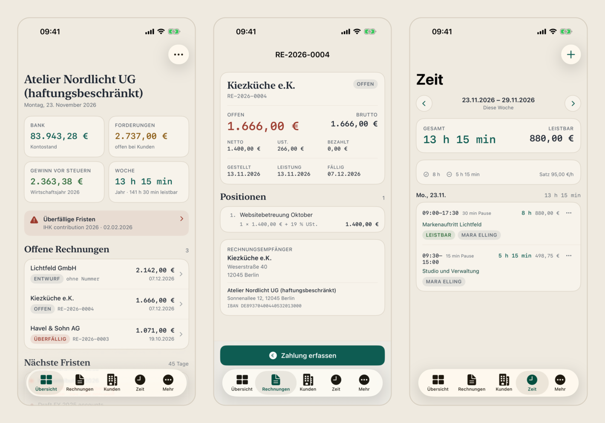

# iPhone-App

`ios/` ist ein nativer SwiftUI-Client für denselben lokalen Schreibtisch. Er ist kein zweites Backend und hält keine Kopie der Bücher: Jeder Bildschirm liest vom Next.js-Server auf deinem Mac über das lokale WLAN. Der Mac besitzt weiterhin `data/managr.db` und das Journal.



Die Bilder zeigen die Beispielgesellschaft, die beim ersten Start geladen wird.

## Was die App kann

- **Übersicht** — Bank, Forderungen, Gewinn vor Steuern, offene Rechnungen, die nächsten Fristen, offene Aufgaben und die Zeit der Woche.
- **Rechnungen** — Liste, Suche und Filter; eine Rechnung öffnen; einen Entwurf ausstellen; eine Zahlung auf den offenen Betrag buchen. Die Sperren aus der §14-UStG-Prüfung stehen vor dem Ausstellen.
- **Kunden** — Liste, Suche, Anlegen und Bearbeiten; offener Betrag, Umsatz, Zeit, Projekte und die Rechnungen des Kunden.
- **Zeit** — Wochenwechsel, Summen, Einträge mit Aktivitäten und Arbeitszeitwarnungen; eine neue Zeit buchen; einen Eintrag löschen (weich gelöscht, im Schreibtisch wiederherstellbar).
- **Mehr** — Personen, Projekte, Aufgaben, Fristen und Einstellungen für Verbindung, Sprache und Firma.
- **Firmenwechsel** und eine **deutsche/englische** Oberfläche.

Nicht in der App: eine Rechnung mit verknüpften Zeitpositionen anlegen, einen Entwurf bearbeiten, Dokumente und Uploads, Qonto, Steuererklärungen, die Buchführung und der Assistent. Dafür den Browser verwenden.

## Wie sie mit dem Schreibtisch spricht

Gelesen wird dasselbe View-JSON wie im Browser:

```
GET /api/views/desk
GET /api/views/invoices
GET /api/views/invoice?id=4
GET /api/views/time?week=2026-11-23
```

Geschrieben wird über eine einfache JSON-Fassade vor dem Werkzeugregister:

```http
POST /api/tools
Content-Type: application/json

{ "name": "record_invoice_payment",
  "arguments": { "invoiceId": 4, "amount": "1666,00", "paidOn": "2026-11-23" } }
```

```json
{ "ok": true, "data": { "amountCents": 166600, "paymentId": 9, "journalEntryId": 130 } }
```

`src/app/api/tools/route.ts` ruft `runTool` aus `src/server/tools.ts` auf, dasselbe Register, das der MCP-Endpunkt und der Assistent verwenden. Validierung, Domänenregeln und Journalbuchungen sind identisch. `GET /api/tools` listet die Werkzeuge und ihre JSON-Schemata. Next.js Server Actions werden nicht verwendet, weil ihre IDs Build-Artefakte sind.

## Den Schreibtisch starten

```bash
bun install
bun run dev
```

Next gibt eine **Network**-Adresse aus, zum Beispiel `http://192.168.1.20:3000`. Lass den Schreibtisch laufen und verwende diese Adresse auf dem Telefon; `localhost` würde das Telefon selbst bedeuten. Telefon und Mac müssen im selben WLAN sein.

## Bauen und installieren

Das Projekt ist `ios/Managr.xcodeproj`, erzeugt aus `ios/project.yml` mit XcodeGen.

1. Das Projekt in Xcode öffnen.
2. Das Ziel **Managr** → **Signing & Capabilities** wählen, das Team eintragen und bei Bedarf die Bundle-ID ändern.
3. Das iPhone anschließen, entsperren und **Run** drücken.
4. Den Entwickler unter **Einstellungen → Allgemein → VPN & Geräteverwaltung** vertrauen.
5. Die App öffnen, die Network-Adresse eingeben und den Zugriff aufs **lokale Netzwerk** erlauben.

Eine kostenlose Apple-ID signiert sieben Tage; ein bezahltes Apple-Developer-Konto ein Jahr. Die vollständige Anleitung, Fehlersuche und der Bau über die Kommandozeile stehen in [`ios/README.md`](https://github.com/403access/managr/blob/main/ios/README.md).

## Sicherheit

Es gibt keine Anmeldung, wie im übrigen Schreibtisch. Die Views und `/api/tools` sind für alles im selben Netzwerk erreichbar. Den Schreibtisch daher in einem vertrauenswürdigen WLAN betreiben und Port 3000 nie ins Internet weiterleiten. Die Anfragen laufen im lokalen Netz über einfaches HTTP; die App hat dafür eine ATS-Ausnahme. Nichts geht an einen Cloud-Dienst, und die App speichert nur die Adresse des Schreibtischs und die Sprache.